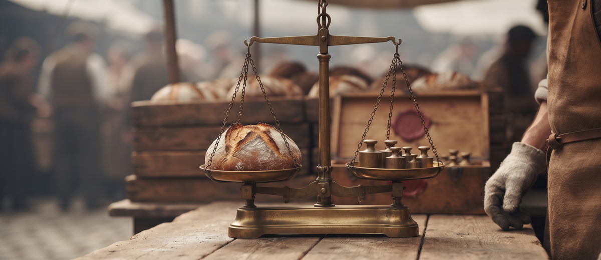
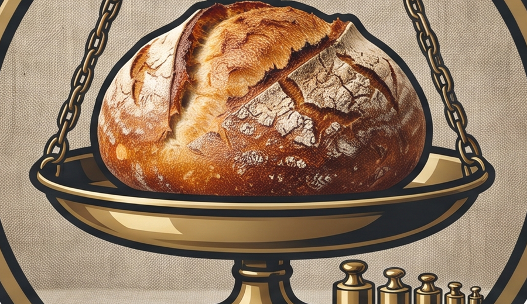
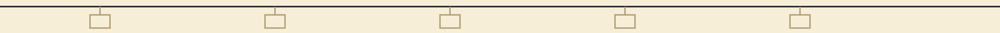
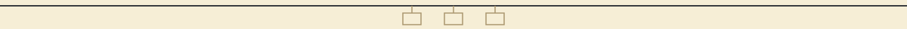

> Day book plate: the date line of the book, ruled like an entry heading. A tiny bin glyph sits beside this heading and no other.

# codeintel-Configuration-File-Validator

Validates configuration files (JSON or YAML) against a JSON Schema, or runs the one built in best practice check: the top level api_key must not be left at its default placeholder value, and a failure of that check exits 1. Identifies missing required fields and incorrect data types against the schema. Uses `jsonschema`. - Focused on Tools for static code analysis, vulnerability scanning, and code quality assurance

> **Bin door inset: the one built in check.** The top level api_key must not be left at its default placeholder value, and a failure of that check exits 1. That single, present tense judgement is the whole built in rule of the place.

## Install
`git clone https://github.com/ShadowStrikeHQ/codeintel-configuration-file-validator`

> **Bin door inset: clone line flagged.** The install line above points to ShadowStrikeHQ, not to ShadowGuard-AI. It is preserved as printed and flagged here, not quietly corrected. The README gives no dependency step after the clone, although it names jsonschema as the library in use.

## Usage
`./codeintel-configuration-file-validator [params]`

> **Bin door inset: usage line flagged.** The usage line above is a placeholder, and the parameter list below names no configuration file argument at all, listing only options, so the README gives no true usage line.

## Parameters
- `-h`: Show help message and exit
- `--schema_file`: Path to the JSON schema file. If not provided, the tool only checks that the configuration file parses, unless `--best_practice` is given.
- `--format`: Specify the format of the configuration file. If not given, it will be inferred from the file extension.
- `--best_practice`: Run the one best practice check: the top level api_key must not be left at its default placeholder value. A failure exits 1.

> **Bin door inset: without a schema, only parsing is checked.** The --schema_file entry above carries its condition in full: if no schema is provided, the tool only checks that the configuration file parses, unless --best_practice is given. The --format entry carries its inference condition in full as printed.

## License
Copyright (c) ShadowStrikeHQ

> **Bin door inset: copyright line flagged.** The closing line above reads Copyright (c) ShadowStrikeHQ, preserved as printed and flagged beside the install fault.
